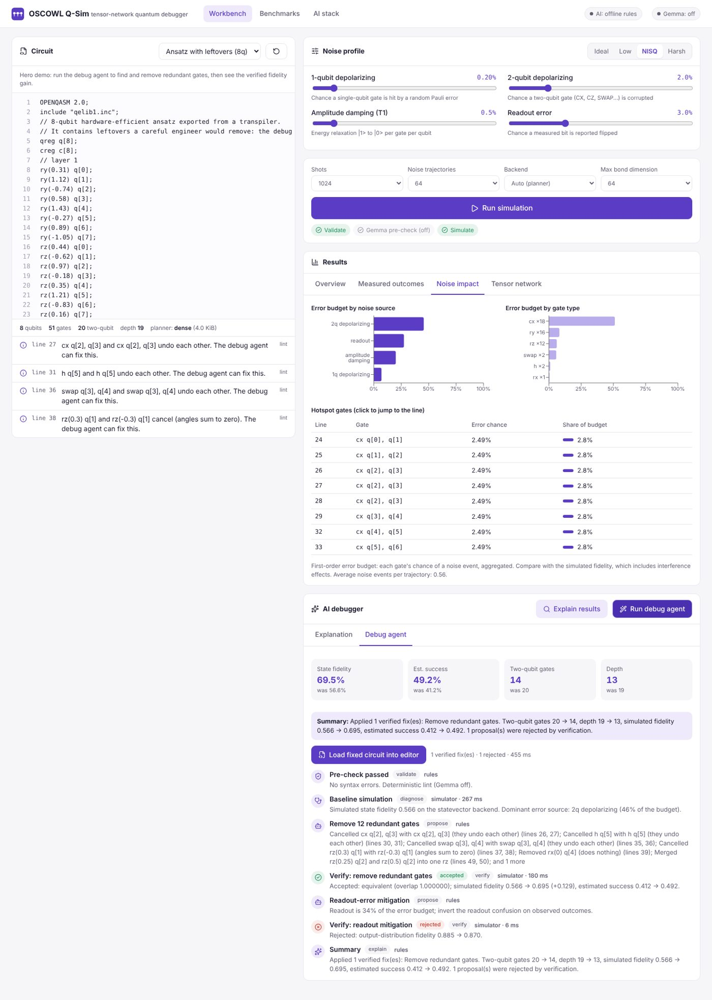

# OSCOWL Q-Sim

**Debug quantum software before you pay for quantum hardware.**

OSCOWL Q-Sim is a cloud-native quantum test bench. It simulates OpenQASM circuits as
**tensor networks (matrix product states)** so structured circuits with 100+ qubits fit in
kilobytes, applies realistic **noise models**, shows **where fidelity is lost, gate by gate**, and
runs a **debug agent** that proposes fixes and accepts only the ones that simulation proves are
equivalent and better. Gemini explains results and proposes rewrites, Gemma pre-checks circuits,
and everything still works offline with rule-based fallbacks.



## What it does

| | |
|---|---|
| **Circuit input** | OpenQASM 2.0 and 3.0 (the subset Qiskit and Cirq export), gate definitions, register broadcasting. Errors come with line numbers and "did you mean" hints. |
| **Two simulators** | Exact dense state vector for small circuits; MPS tensor network for large structured ones, with a planner that predicts the bond dimension and picks the backend. |
| **Noise** | 1- and 2-qubit depolarizing, amplitude damping (T1), and readout error, simulated with quantum trajectories. |
| **Metrics** | State fidelity (± error), output (Hellinger) fidelity against exact ideal probabilities, estimated success probability, and the MPS truncation error bound. |
| **Noise attribution** | Error budget by noise source, gate type, qubit and layer, plus hotspot gates linked to source lines. |
| **AI layer** | Gemma 4 pre-check, Gemini 3.8 Flash explanations, Gemini 4 Argon rewrites, and Agent Skills (`backend/app/ai/skills`). An offline mode is used when no key is set. |
| **Debug agent** | Validate → diagnose → propose → **verify by simulation** → accept/reject → explain. |
| **Benchmarks** | Dense vs MPS time and memory against qubit count, with real measured numbers in the UI. |
| **Deploy** | One Docker image for Cloud Run; GKE GPU/TPU batch jobs through a worker CLI with the JAX backend. |

**Honest scope:** up to 100+ qubits for *structured, low-entanglement* circuits (GHZ, shallow
ansätze, many chemistry and optimisation circuits), with controllable fidelity and a reported
error bound. Highly entangled deep circuits still grow exponentially. The planner warns you, and
every result carries its truncation error.

## Quick start (Windows + Git Bash + VS Code)

Prerequisites: **Python 3.11–3.13**, **Node.js 22 LTS**, **Git for Windows** (includes Git Bash) and **VS Code**.
Full walkthrough with troubleshooting: [docs/SETUP_WINDOWS.md](docs/SETUP_WINDOWS.md).

```bash
cd oscowl-qsim
bash scripts/setup.sh      # creates .venv, installs Python + Node packages, creates .env
bash scripts/dev.sh        # backend on :8000 + frontend on :5173
```

Open **http://localhost:5173**. You can also use VS Code: *Terminal → Run Task → "Dev: start everything"*.

Try this first:
1. Leave the default example (**Ansatz with leftovers**) and press **Run simulation**.
2. Open **Noise impact**: two-qubit gates dominate the error budget. Click a hotspot to jump to its line.
3. Press **Run debug agent**. It removes 12 redundant gates, proves the new circuit is equivalent (overlap 1.000000) and shows the fidelity gain. Then **Load fixed circuit into editor**.
4. Pick **GHZ state (100q)** → Run → **Tensor network** tab: 100 qubits at bond dimension 2 in about 12 KiB.
5. Check the **Benchmarks** tab for dense vs MPS time and memory.

Other commands:

```bash
bash scripts/test.sh       # 30 backend tests + frontend type check
bash scripts/bench.sh      # regenerate benchmark numbers on your machine (--quick for a fast run)
bash scripts/build-ui.sh   # build the UI into backend/static, serve everything from :8000
docker compose up --build  # production container on :8080
```

## Your to-do list (things that need your accounts)

The code is complete and runs offline. These steps need your own credentials or decisions:

1. **Gemini API key** (5 min): create one in Google AI Studio and put it in `.env` as `GEMINI_API_KEY=...`, then restart the backend. The header pills switch from "offline rules" to the Gemini models. See [docs/GOOGLE_AI_SETUP.md](docs/GOOGLE_AI_SETUP.md).
2. **Check the model IDs** in `.env` against the AI Studio model list (defaults: `gemini-3.8-flash`, `gemini-4-argon`, `gemma-4-26b-a4b-it`).
3. **Optional local Gemma**: install Ollama, pull a Gemma 4 model, and set `GEMMA_PROVIDER=ollama`.
4. **Google Cloud deploy**: create a project with billing, install the gcloud CLI, then run `deploy/cloudrun/deploy.sh`. See [docs/GCP_DEPLOY.md](docs/GCP_DEPLOY.md).
5. **GitHub**: `git init && git add . && git commit -m "OSCOWL Q-Sim MVP"`, then push to a new repository.
6. **Benchmarks on your laptop**: run `bash scripts/bench.sh` so the Benchmarks tab shows your machine's numbers. The committed file was measured on a Linux cloud container.
7. **Team details**: add names to this README and to the demo script.

## Project structure

```
oscowl-qsim/
├── backend/
│   ├── app/
│   │   ├── main.py              FastAPI app (serves the built UI in production)
│   │   ├── config.py            settings from .env
│   │   ├── api/routes.py        REST endpoints (/api/docs for interactive docs)
│   │   ├── quantum/             parser, gates, statevector, MPS, noise, planner,
│   │   │                        error budget, optimizer, readout mitigation, engine
│   │   ├── ai/                  Gemini/Gemma client, validator, explainer, debug agent
│   │   │   └── skills/          Agent Skills (SKILL.md) loaded into prompts on demand
│   │   ├── examples/            demo circuits + manifest
│   │   └── worker.py            batch job CLI (GKE GPU/TPU)
│   ├── adk_agents/qsim_debugger Google ADK agent exposing the same tools
│   └── tests/                   pytest suite
├── frontend/                    React + TypeScript + Vite UI
├── benchmarks/benchmark.py      dense vs MPS benchmark (results/latest.json)
├── deploy/                      Cloud Run script, GKE GPU/TPU job manifests
├── sdk/python/oscowl_client.py  single-file Python client (Qiskit-friendly)
├── scripts/                     setup / dev / test / bench / build (Git Bash)
├── docs/                        setup, Google AI, deploy, architecture, API, demo script
└── Dockerfile, docker-compose.yml
```

## Documentation

- [docs/SETUP_WINDOWS.md](docs/SETUP_WINDOWS.md): step-by-step setup and troubleshooting
- [docs/GOOGLE_AI_SETUP.md](docs/GOOGLE_AI_SETUP.md): Gemini key, Gemma (API or Ollama), Vertex AI, ADK, Agent Skills, Antigravity
- [docs/GCP_DEPLOY.md](docs/GCP_DEPLOY.md): Cloud Run, Secret Manager, GKE GPU/TPU jobs
- [docs/ARCHITECTURE.md](docs/ARCHITECTURE.md): how the pieces fit, and the verification principle
- [docs/API.md](docs/API.md): endpoints with examples
- [docs/DEMO_SCRIPT.md](docs/DEMO_SCRIPT.md): the 2-minute demo

## License

MIT, see [LICENSE](LICENSE).
