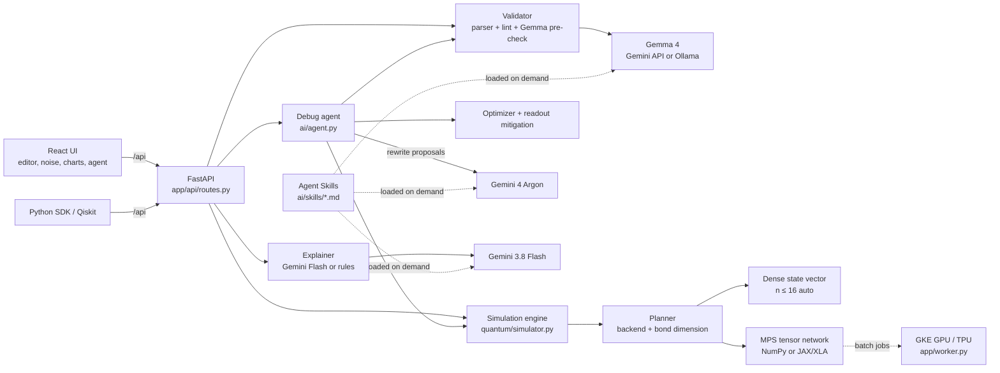

# Architecture

## Request flow: "Run simulation"

1. **Validate** (`ai/validator.py`): the parser reports syntax errors with lines and hints. Lint rules flag redundant gates, long-range interactions, unused qubits, missing measurements and size limits.
2. **Gemma pre-check** (optional): a small, fast model looks for *logic* mistakes using the `qasm-lint` skill.
3. **Plan** (`quantum/planner.py`): bounds the MPS bond dimension per cut from the two-qubit gates crossing it, and chooses the dense or MPS backend and the suggested hardware.
4. **Simulate** (`quantum/simulator.py`):
   - Ideal run, then exact sampling.
   - Noisy runs as **quantum trajectories**: random Pauli errors, amplitude-damping jumps, then readout flips.
   - State fidelity is the mean |⟨ideal|trajectory⟩|² (an unbiased estimate of ⟨ψ|ρ|ψ⟩).
   - Hellinger fidelity uses **exact** ideal probabilities of the observed outcomes.
5. **Error budget** (`quantum/budget.py`): a first-order attribution by source, gate type, qubit, layer and hotspot line, plus the estimated success probability (ESP).

## The debug agent: verify before accept

`ai/agent.py` follows a loop the user can audit in the UI timeline:

| Phase | What happens |
|---|---|
| validate | Parser, lint and Gemma pre-check |
| diagnose | Baseline noisy simulation; dominant noise source |
| propose | Deterministic rewrites (cancel inverse pairs, merge rotations, drop identities); a Gemini 4 Argon rewrite when online; readout mitigation when readout is a large share |
| verify | Each circuit change must keep the **ideal-state overlap ≥ 0.999**, raise ESP, and not lower simulated fidelity beyond statistical noise. Mitigation must raise Hellinger fidelity against exact ideal probabilities. |
| explain | Summary by Gemini Flash, or rules when offline |

An LLM proposal is never trusted on its own: physics decides.

## MPS core in one paragraph

The state is a chain of tensors A[i] of shape (χ_left, 2, χ_right). One-qubit gates act locally.
A two-qubit gate on neighbours contracts two tensors, applies the gate, and splits them again with an
SVD, keeping at most `max_bond` singular values. The discarded weight is accumulated into a
**truncation fidelity**, the error bound shown in the UI. Distant qubits are routed with SWAPs. The
chain is kept in mixed-canonical form, so truncations are optimal and amplitude-damping probabilities
are local. Sampling is exact and vectorised over shots. Memory is about 32·n·χ² bytes, compared with
16·2ⁿ bytes for a dense state.

## Limits (by design, for this MVP)

- Terminal measurements only (no mid-circuit measurement or classical control).
- Noise is gate-attached; there is no idle or crosstalk noise yet.
- Circuits with high entanglement need large χ: results become approximate (reported), or slow.
- The JAX backend is functional but dispatches operations eagerly; JIT-compiled fixed-χ kernels are the next performance step for TPUs.

## Roadmap ideas

Noise models calibrated from real device data, qubit re-mapping fixes, idle noise, JIT-compiled MPS
sweeps on TPU, PEPS/tree tensor networks for 2D circuits, and multi-tenant job queues (Pub/Sub plus Cloud Run jobs).
